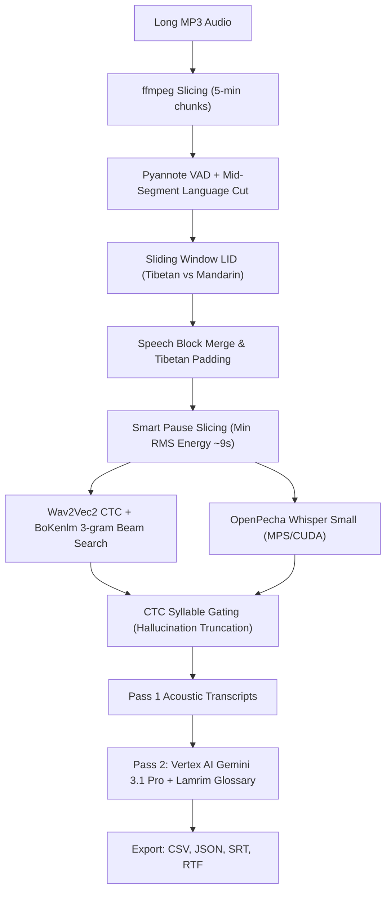

# Tibetan-Chinese Dharma Speech-to-Text & Translation Pipeline

A production-grade, modular Python pipeline for transcribing Lhasa-dialect Tibetan Buddhist teachings (e.g. Geshe oral commentary on Tsongkhapa's *Lamrim Chenmo* 《菩提道次第廣論》) and generating faithful, contextually aware Traditional Chinese translations.

---

## Key Highlights

- **Dual-Acoustic ModelFusion**: Combines OpenPecha's fine-tuned Whisper (`openpecha/op-whisper_small-ft-v2`) and 1.28GB Wav2Vec2 CTC acoustic model (`openpecha/op-wav2vec2-ft-v17`) with a 259MB 3-gram BoKenlm syllable language model (`openpecha/BoKenlm-syl-v0.4`).
- **Hallucination Elimination**: Frame-synchronous CTC syllable counts dynamically truncate autoregressive Whisper hallucinations during zero-padded silence windows.
- **Smart Breath-Pause Slicing**: Automatically finds minimum RMS energy regions (80ms windows) to slice audio naturally between sentences without cutting spoken syllables in half.
- **High-Recall Tibetan/Chinese Language Identification (LID)**: Automatically separates the Tibetan Geshe's speech from the on-site Mandarin Chinese interpreter.
- **Pass 2 Orthography Restoration & Translation**: Uses Gemini 3.1 Pro (via Vertex AI) to cross-reference acoustic transcripts against *Lamrim Chenmo* doctrinal glossaries, restore colloquial Lhasa phonetic spellings to standard classical Tibetan orthography, and generate fluent Traditional Chinese translations.
- **Multi-Format Export**: Generates `bilingual_transcript.csv`, `bilingual_transcript.json` (compatible with `buddhistAI-translation`), `.srt` (subtitles), `.rtf` (formatted reading documents), and `speech_lang_timeline.csv`.

---

## System Requirements

- **Operating System**: macOS (Apple Silicon M1/M2/M3/M4 with Metal Performance Shaders GPU acceleration) or Linux (NVIDIA CUDA or CPU).
- **System Tools**: `ffmpeg` (version 5.0+ recommended).
- **Python**: 3.10, 3.11, or 3.12.

---

## Quickstart & Installation

### 1. Clone Repository & Install FFmpeg

```bash
git clone https://github.com/nightheronry/whisper-jax.git
cd whisper-jax

# macOS (Homebrew)
brew install ffmpeg xz

# Ubuntu / Debian
sudo apt-get update && sudo apt-get install -y ffmpeg liblzma-dev
```

### 2. Environment Setup

Choose either **Conda** (recommended) or standard **venv**:

#### Option A: Conda / Miniforge
```bash
conda env create -f environment.yml
conda activate whisper-jax
```

#### Option B: Standard Python Virtualenv
```bash
python3 -m venv .venv
source .venv/bin/activate
pip install --upgrade pip setuptools wheel
pip install -r requirements.txt
```

### 3. One-Click Model Setup & Verification

Run the automated setup script. It will check your environment, verify dynamic library preloading (`liblzma` for KenLM on macOS), and automatically download and extract the compact 259MB `bokenlm_syl_v04_3gram.arpa` into `.cache/`:

```bash
python setup_models.py
```

*(Optional)* To also pre-download all HuggingFace acoustic and alignment models:
```bash
python setup_models.py --download-hf
```

---

## Google Cloud / Vertex AI Setup (For Pass 2 Translation)

Pass 2 translation uses the Google Gen AI SDK on Vertex AI. You can authenticate using either standard Google Cloud ADC or an API key:

### Method A: Application Default Credentials (Standard)
```bash
gcloud auth application-default login
gcloud auth application-default set-quota-project YOUR_GCP_PROJECT_ID

export GOOGLE_CLOUD_PROJECT="YOUR_GCP_PROJECT_ID"
export VERTEX_LOCATION="global"
```

### Method B: API Key (Express Mode)
```bash
export GOOGLE_CLOUD_API_KEY="YOUR_GEMINI_API_KEY"
```

> **Note**: If no Vertex AI credentials are provided, the pipeline will still execute Pass 1 acoustic recognition (Whisper + Wav2Vec2 CTC) and export raw Tibetan transcripts without failing.

---

## CLI Usage

### Basic Usage (Tibetan Speech Only)
Transcribes Tibetan speech and generates Traditional Chinese translations using the Lamrim page 1 preset:

```bash
python transcribe.py 900121b_P001.mp3 --mode bo_only --lamrim-page 1
```

### Bilingual Mode (Tibetan Geshe + Chinese Interpreter)
Transcribes both the Tibetan speaker and the live Chinese interpreter:

```bash
python transcribe.py 900121b_P001.mp3 --mode bilingual --device mps
```

### Custom Scripture Reference Text
Anchor technical terminology and Buddhist verses using custom scripture text:

```bash
python transcribe.py 900121b_P001.mp3 --reference-text path/to/scripture.txt
```

### All CLI Options

```text
usage: transcribe.py [-h] [-o OUTPUT_DIR] [--mode {bo_only,bilingual}]
                     [-p LAMRIM_PAGE] [-r REFERENCE_TEXT]
                     [--device {mps,cuda,cpu}]
                     [--chunk-duration CHUNK_DURATION] [--force] [--no-vertex]
                     [--vertex-model VERTEX_MODEL] [--api-key API_KEY]
                     audio

positional arguments:
  audio                 Path to input audio file (mp3, wav, m4a, flac, etc.)

options:
  -h, --help            Show this help message and exit
  -o, --output-dir      Output directory (defaults to <audio_filename_stem>/)
  --mode                'bo_only' (Geshe Tibetan + Chinese translation) or
                        'bilingual' (includes on-site interpreter speech)
  -p, --lamrim-page     Lamrim Chenmo page preset (e.g. '1') to anchor terms
  -r, --reference-text  Path to scripture reference file or raw text string
  --device              Compute device: 'mps' (Apple Silicon), 'cuda', or 'cpu'
  --chunk-duration      Slice duration in minutes for ffmpeg chunking (default: 5)
  --force               Force re-processing chunks (ignores existing checkpoints)
  --no-vertex           Skip Pass 2 Vertex AI orthography restoration & translation
  --vertex-model        Override Gemini model ID (default: gemini-3.1-pro-preview)
  --api-key             Google Cloud API key for express mode
  --thinking-level      Vertex AI thinking level ('LOW' for cost saving, 'HIGH' for deep reasoning; default: LOW)
```

---

## Output Artifacts

All outputs are saved to the designated output folder (defaults to `<audio_stem>/`):

| File | Description |
| :--- | :--- |
| `bilingual_transcript.csv` | Full bilingual transcript table with paragraphs, timestamps, and language labels. |
| `bilingual_transcript.json` | Structured JSON transcript compatible with the `buddhistAI-translation` web interface. |
| `bilingual_transcript_unicode.json` | Unicode Tibetan transcription JSON. |
| `bilingual_transcript.srt` | Subtitle file formatted with timestamps for video players (e.g. VLC, YouTube). |
| `bilingual_transcript.rtf` | Rich Text Format document formatted by timestamped blocks for study and review. |
| `speech_lang_timeline.csv` | Time-coded timeline of speech activity labeled with `bo` vs `zh`. |
| `asr_blocks.json` | Coalesced speech blocks passed to acoustic recognition. |
| `chunk_checkpoints/` | Per-chunk JSON checkpoints for resuming long batch jobs seamlessly. |

---

## Architecture Overview



---

## Repository Structure

```
├── transcribe.py          # Main CLI entry point
├── setup_models.py        # Automated environment & model download script
├── requirements.txt       # Python package dependencies
├── environment.yml        # Conda environment definition
├── src/
│   ├── __init__.py
│   ├── compat.py          # macOS OpenMP & dynamic liblzma preloaders
│   ├── config.py          # Device auto-detection, model paths & Lamrim presets
│   ├── audio.py           # ffmpeg slicing, VAD, LID & pause-based chunking
│   ├── models.py          # Whisper MPS pipeline, Wav2Vec2 CTC & BoKenlm decoder
│   ├── vertex_service.py  # Gemini Pass 2 orthography restoration & translation
│   ├── exporters.py       # Exporters for CSV, JSON, SRT, and RTF
│   └── pipeline.py        # Batch coordinator and checkpoint manager
├── .cache/                # Cached KenLM models & tokenizers
└── vad.ipynb              # Legacy reference notebook
```
